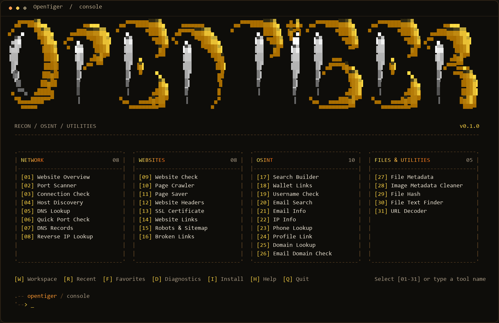
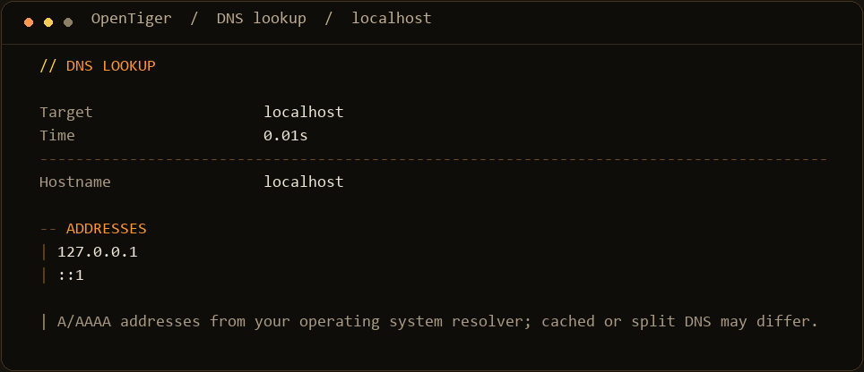

<p align="center">
  
</p>

<p align="center">
  <strong>A terminal toolkit for reconnaissance, public-data lookups, and file inspection.</strong><br>
  Yellow-to-orange ASCII art. Organized tools. Readable results.
</p>

<p align="center">
  <code>Windows</code> &nbsp; <code>Python 3.11+</code> &nbsp; <code>31 tools</code> &nbsp; <code>v0.1.0</code> &nbsp; <a href="LICENSE"><code>Apache-2.0</code></a>
</p>

<p align="center">
  <a href="#install">Install</a> &nbsp; / &nbsp;
  <a href="#inside-the-toolkit">Tools</a> &nbsp; / &nbsp;
  <a href="#use-the-terminal">Usage</a> &nbsp; / &nbsp;
  <a href="#commands-and-reports">Commands &amp; reports</a> &nbsp; / &nbsp;
  <a href="#development">Development</a>
</p>

---

## The terminal



<sub>Terminal images rendered from the current application output. Colors and font appearance depend on your terminal.</sub>

### More than a menu

| Select | Inspect | Keep |
| :--- | :--- | :--- |
| Find tools in Network, Websites, OSINT, and Files & Utilities. | Read aligned fields, record tables, and errors with recovery hints. | Save runs in a workspace, export JSON or HTML, and compare findings between runs. |

All **31 tools** use OpenTiger implementations and the same input, results, and export workflow. Each is available through the menu or a direct command, with JSON and standalone HTML export.

## Install

**You need:** Windows, Python **3.11 or later**, and an internet connection for dependencies. Get Python from [python.org](https://www.python.org/downloads/windows/) if needed.

1. Download and extract the **complete project** into a folder you plan to keep.
2. Double-click **`Install-OpenTiger.cmd`**.
3. After installation succeeds, close and reopen your terminal.
4. Run:

```powershell
opentiger
```

The installer creates the project's `.venv`, installs requirements, checks dependency compatibility, and adds the command to **your user PATH**. No administrator access is needed for installation. Afterward, `opentiger` works from any folder.

<details>
<summary><strong>Manual setup and troubleshooting</strong></summary>

If the command isn't recognized, close all Windows Terminal windows and reopen it. Existing terminals can retain the old PATH.

Keep the extracted folder in place. If you move it, run `Install-OpenTiger.cmd` again to update the command.

To run directly from the project folder without registering the command:

```powershell
python -m venv .venv
.\.venv\Scripts\python -m pip install -r requirements.txt
.\.venv\Scripts\python -m opentiger
```

After dependencies are installed, you can also double-click `Start-OpenTiger.cmd`.

</details>

## Connected investigations

OpenTiger 0.1.0 includes connected investigations: target workspaces, six-stage Website Overview, HTML exports, report comparisons, menu search, recent targets, favorites, diagnostics, certificate-expiry countdowns, and bounded broken-link checks.

```powershell
# Set a target once, then run tools against it
opentiger workspace create demo https://example.com
opentiger overview --workspace demo --html first.html --output first.json
opentiger dns --workspace demo

# Save a second run and compare its evidence
opentiger overview --workspace demo --output second.json
opentiger compare first.json second.json --html changes.html

# Manage frequently used commands and check your setup
opentiger favorite add overview
opentiger diagnostics
```

Workspace records, immutable run files, recent targets, and favorites are stored under `~/.opentiger`. Set `OPENTIGER_HOME` to use another storage location. Explicit targets run independently unless you provide `--workspace`; omitted targets use the active compatible workspace. Certificate countdowns retain verified TLS behavior. Ctrl+C during Website Overview, Username Check, or Broken Links returns partial results collected so far; workspace runs preserve those results.

[Workflow guide and limitations →](docs/WORKFLOWS.md)

## Inside the toolkit

| Category | Tools | What you can do |
| :--- | :---: | :--- |
| **Network** | 8 | Scan ports and hosts, resolve DNS records, and look up PTR hostnames. |
| **Websites** | 8 | Inspect headers and certificates, discover links, read robots/sitemap files, and save page resources. |
| **OSINT** | 10 | Query registration and email-domain data, check public GitHub/GitLab usernames, inspect phone-number formats, and generate search and wallet-explorer links. |
| **Files & Utilities** | 5 | Inspect file metadata, create clean image copies, hash files, extract strings, and decode URLs. |

**[Browse all 31 tools →](docs/TOOLS.md)**

Online lookups depend on public services and their availability. Email Domain Check inspects DNS policy; it does not verify that a mailbox exists. Reverse IP Lookup resolves PTR records; it does not enumerate every website on an address.

## Use the terminal

| Input | Action |
| :--- | :--- |
| **`01`–`31`** | Open the corresponding tool. |
| **`W`** | Create, select, or inspect target workspaces. |
| **`R`** | Reuse a recent target with a tool. |
| **`F`** | Run favorites; use `+command` to add or `-command` to remove. |
| **`D`** | Run local diagnostics. |
| **`I`** | Install all requirements and check dependencies. |
| **`H`** | Show help. |
| **`V`** | Show version and attribution. |
| **`Q`** | Quit. |
| **`back`** | Return to the menu from any tool input prompt. |
| **Enter** | Accept a displayed default where the tool offers one. |

Tools are numbered down each category: **Network 01–08**, **Websites 09–16**, **OSINT 17–26**, and **Files & Utilities 27–31**.

Once you select a tool, enter the **requested value**, such as `example.com`, a URL, an IP address, or a file path. Tool numbers belong at the menu prompt.

You can also type an exact tool command or search by part of a tool name. The layout adapts to your terminal width. Set the `NO_COLOR` environment variable to disable menu and result colors.

## Commands and reports

All 31 tools also have direct commands. For example:

```powershell
# Resolve a hostname
opentiger dns localhost

# Inspect DNS records and email-domain configuration
opentiger dns-records example.com
opentiger email-domain example.com

# Decode a URL locally, without visiting it
opentiger url-decode "https://example.com/a%20b?tag=one&tag=two"

# Return machine-readable output or save it to a new file
opentiger dns localhost --json
opentiger dns localhost --output lookup.json
```



OpenTiger's direct commands support `--json`, `--output`, `--html`, and `--timeout`. Use `opentiger --help` for the command list and `opentiger ports --help` for port-selection options. `--timeout` applies per network operation, not to the entire run; OS-level DNS resolution has its own timeout behavior.

**Reports:** JSON exports create new files and refuse to overwrite existing ones. Page Saver writes uniquely named HTML files under `reports/pages`. Image Metadata Cleaner writes a new image beside the original.

**Requirements shortcut:** `I` runs `python -m pip install -r requirements.txt` using the Python running OpenTiger, and prepares the project `.venv` if it is different. You can also run `opentiger install`.

<details>
<summary><strong>Practical limits and data handling</strong></summary>

- Network tools contact the supplied destination. Domain Lookup sends the query to `rdap.org` and follows the registration-service redirect.
- Website Links reads one HTML page, without JavaScript execution. It returns up to 200 internal and 200 external links.
- Website Links and Robots & Sitemap read up to 2 MB per response. Discovery-file previews show up to 12,000 characters per file.
- Quick Port Check inspects at most 256 selected TCP ports on one resolved address, with up to 16 workers. Service names are hints, not software identification.
- File Text Finder reads up to 16 MB and returns the first 100 printable ASCII strings. File Hash and URL Decoder stay local.
- Header presence, a filename, and a hash are observations, not proof of safety or a vulnerability.
- Reports can contain supplied URLs and returned information. Avoid putting secrets in target URLs.
- Search Builder, Email Search, Wallet Links, and Profile Link generate links locally. Username Check makes at most two public API requests, to GitHub and GitLab; found, not found, blocked/rate-limited, and unknown remain separate. It does not identify a person across sites.
- Page Crawler follows same-origin HTML links up to a configurable page cap. It does not execute JavaScript, submit forms, log in, or enforce robots rules.
- Website Check reviews page transport and form actions; it does not test exploit payloads.
- Image Metadata Cleaner supports single-frame PNG and JPEG, preserves the original, and recompresses JPEG output. It does not anonymize visible image content.

</details>

> Use network checks on systems you own or are authorized to assess. Findings are observations, not guarantees of security or identity.

## Development

From the project folder, run the local test suite:

```powershell
.\.venv\Scripts\python -m unittest discover -s tests -v
```

| Location | Purpose |
| :--- | :--- |
| `opentiger/terminal.py` | Colors, ASCII layout, prompts, and menu panels. |
| `opentiger/results.py` | Result tables, field formatting, and recovery messages. |
| `opentiger/tools.py` · `opentiger/extras.py` | OpenTiger inspection tools. |
| `opentiger/workbench.py` | Native web, network, file, and lookup workflows. |
| `opentiger/catalog.py` | Tool labels, commands, and stable menu IDs. |
| `opentiger/investigations.py` | Website Overview, username checks, and bounded link checks. |
| `opentiger/workspaces.py` | User-local target workspaces, history, recent targets, and favorites. |
| `opentiger/reporting.py` | Self-contained HTML exports and semantic report comparison. |

Refresh the README's terminal images from the current code:

```powershell
.\.venv\Scripts\python docs/render_previews.py
```

The terminal image renderer uses Pillow from the project requirements and performs a local `localhost` DNS lookup. See the [workflow guide](docs/WORKFLOWS.md) for input, storage, and reporting behavior.

## Libraries

OpenTiger's application code lives in `opentiger/`. Its dependencies are **dnspython**, **Pillow**, and **phonenumbers**, with their respective licenses. See [dependency notices](THIRD_PARTY_NOTICES.md).

## License

Copyright 2026 NerdBlud. OpenTiger is licensed under the **[Apache License 2.0](LICENSE)**. See [NOTICE](NOTICE) for project attribution and [dependency notices](THIRD_PARTY_NOTICES.md) for separately licensed libraries.

---

<p align="center"><strong>OpenTiger</strong> &nbsp; · &nbsp; Recon / OSINT / Utilities</p>
